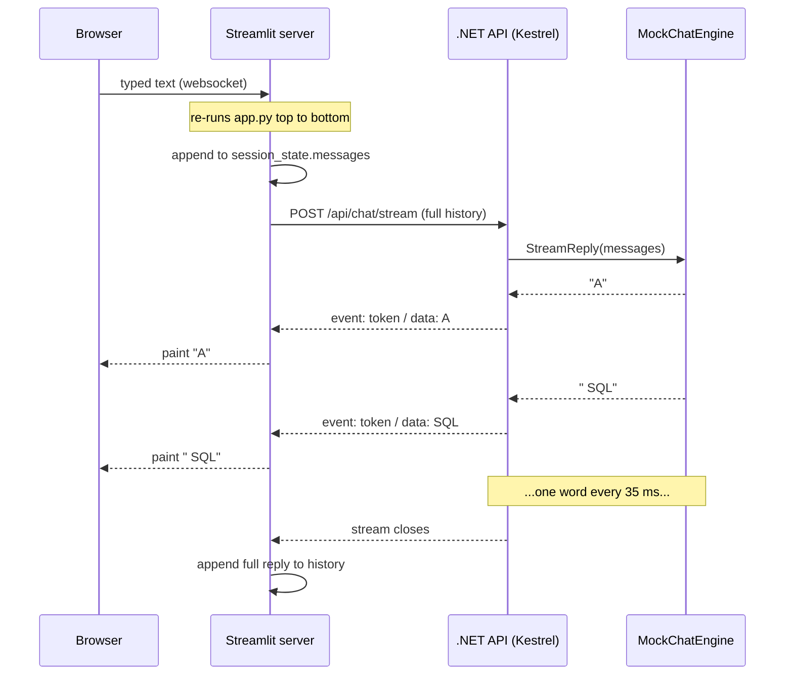

# Architecture

A walkthrough of how this chatbot is put together, written so you can read it once and
then explain it to someone else. [README.md](README.md) covers *running* it; this file
covers *why it is built this way*.

---

## 1. The one-paragraph version

Two processes on your laptop. A **Streamlit** page (Python, port 8501) draws the chat
window and holds the conversation history. An **ASP.NET Core minimal API** (.NET 10,
port 5179) produces the replies. When you type a message, Streamlit sends the *entire*
conversation to the backend over HTTP; the backend feeds it to a small rule-based class
called `MockChatEngine` and streams the answer back one word at a time as
server-sent events; Streamlit paints each word as it arrives. There is no database, no
model provider, and no API key — the "brain" is deliberately a stub you can replace.

---

## 2. The big picture

```
   YOUR BROWSER                         TWO LOCAL PROCESSES
┌──────────────────┐
│                  │   websocket   ┌─────────────────────────────┐
│  localhost:8501  │◄─────────────►│  Streamlit  (Python)        │
│                  │   (Streamlit's │  frontend/app.py            │
│  chat bubbles,   │    own channel)│                             │
│  text box,       │                │  • draws the UI             │
│  sidebar         │                │  • owns chat history        │
└──────────────────┘                │    (st.session_state)      │
                                    └──────────────┬──────────────┘
                                                   │
                                     HTTP POST     │  JSON in,
                                     /api/chat/... │  SSE out
                                                   ▼
                                    ┌─────────────────────────────┐
                                    │  Kestrel  (.NET 10)         │
                                    │  localhost:5179             │
                                    │                             │
                                    │  Program.cs   ── endpoints  │
                                    │       │                     │
                                    │       ▼                     │
                                    │  MockChatEngine.cs ── reply │
                                    │       ▲                     │
                                    │       └── swap this for a   │
                                    │           real model        │
                                    └─────────────────────────────┘
```

The important thing to notice: **the browser never talks to the backend directly.**
Streamlit's page talks only to the Streamlit server; the Streamlit *server* is the thing
that calls the .NET API. That is why the Python code uses `requests` and not JavaScript
`fetch`.

> Because of this, the CORS policy in the backend is belt-and-braces rather than strictly
> required — a server-to-server call isn't subject to the browser's same-origin rules. It
> is kept so that the API still works if you later point a real browser-side client at it.

---

## 3. Why two processes instead of one?

| | Reason |
| --- | --- |
| **Language fit** | Streamlit gives you a chat UI in ~30 lines of Python. Writing the same thing in HTML/JS would be more code for less polish. |
| **Separation of concerns** | The UI knows nothing about how replies are made; the API knows nothing about how they are displayed. You can replace either side independently. |
| **Realism** | This mirrors how real deployments look: a web front end and a separate API service. Swapping Streamlit for React or Blazor touches no backend code. |

The cost is that you start two things and manage two ports. That is what the two
`run-*.ps1` scripts are for.

---

## 4. Life of one message

This is the part worth memorising — everything else follows from it.

Say you type **"tell me a joke"** and press Enter.

**Step 1 — Streamlit re-runs the whole script.**
This is the single most surprising thing about Streamlit and the key to reading
[frontend/app.py](frontend/app.py). On *every* interaction, Streamlit executes `app.py`
from the first line to the last, top to bottom. There is no event handler, no callback.
Your typed text arrives as the return value of `st.chat_input(...)` on line 78.

**Step 2 — The message is appended to history.**
`st.session_state.messages` is the one thing that survives a re-run. It is a plain list
of dicts:

```python
[
  {"role": "user",      "content": "hello"},
  {"role": "assistant", "content": "Hello! I'm a mock chatbot..."},
  {"role": "user",      "content": "tell me a joke"},   # just added
]
```

**Step 3 — The whole list is POSTed to the backend.**

```http
POST http://localhost:5179/api/chat/stream
Content-Type: application/json
Accept: text/event-stream

{"messages":[{"role":"user","content":"hello"},
             {"role":"assistant","content":"Hello! I'm..."},
             {"role":"user","content":"tell me a joke"}]}
```

Every turn, the *entire* conversation goes over the wire. See
[§7 Stateless backend](#7-design-decisions-and-why) for why.

**Step 4 — ASP.NET Core binds the JSON to C# records.**
The minimal-API endpoint on [Program.cs:40](backend/ChatbotApi/Program.cs#L40) declares a
`ChatRequest` parameter, so the framework deserialises the body into the records in
[Models.cs](backend/ChatbotApi/Models.cs) automatically. `MockChatEngine` is also a
parameter — that one is filled in by dependency injection, because it was registered as a
singleton on [Program.cs:16](backend/ChatbotApi/Program.cs#L16).

**Step 5 — The engine picks a reply.**
[MockChatEngine.Reply](backend/ChatbotApi/MockChatEngine.cs) takes the **last user
message**, lowercases it, pads it with spaces, and checks it against a table of keyword
rules. `"tell me a joke"` contains `"joke"`, so it returns the SQL-join joke. If nothing
matches, the fallback echoes your text back with a word count and turn number.

**Step 6 — The reply is chopped into words and streamed.**
`StreamReply` is an `async IAsyncEnumerable<string>` — a sequence produced lazily over
time. It yields one word every 35 ms. `TypedResults.ServerSentEvents(...)` (a .NET 10
API) turns that sequence directly into an HTTP response stream:

```
event: token
data: A

event: token
data:  SQL

event: token
data:  query
...
```

The response stays open, and each word is flushed as it is produced. The 35 ms delay is
pure theatre — it imitates the pacing of a real model so the UI behaves realistically.

**Step 7 — Python reads the stream and yields chunks.**
`stream_reply` in [app.py:18](frontend/app.py#L18) iterates the response line by line,
keeps only `data:` lines, and strips exactly one space after the colon.

**Step 8 — Streamlit renders it live.**
`st.write_stream(...)` consumes the generator, appends each chunk to the assistant's chat
bubble as it arrives, and — conveniently — *returns the fully concatenated string* when
the stream ends. That return value is appended to `st.session_state.messages` so the
reply survives the next re-run.

### The same thing as a sequence diagram



---

## 5. File-by-file map

### Backend — `backend/ChatbotApi/`

| File | Role |
| --- | --- |
| [Program.cs](backend/ChatbotApi/Program.cs) | The entire web app: builds the host, registers CORS and the engine, declares three endpoints, runs. 48 lines, no controllers, no `Startup` class. |
| [MockChatEngine.cs](backend/ChatbotApi/MockChatEngine.cs) | The "brain". Keyword rule table, echo fallback, and the word-by-word streaming version. **The only file that knows how replies are produced.** |
| [Models.cs](backend/ChatbotApi/Models.cs) | Three C# `record` types describing the JSON contract: `ChatMessage`, `ChatRequest`, `ChatResponse`. |
| [appsettings.json](backend/ChatbotApi/appsettings.json) | Logging levels, the CORS allow-list (`AllowedOrigins`), and the listening port (`Kestrel:Endpoints:Http:Url`). |
| `Properties/launchSettings.json` | Local debug profile, used by `dotnet run` *without* `--no-launch-profile` and by Visual Studio / VS Code. The run script bypasses it. |

### Frontend — `frontend/`

| File | Role |
| --- | --- |
| [app.py](frontend/app.py) | The whole UI: sidebar, chat history rendering, input box, and the two backend clients (`stream_reply`, `fetch_reply`). |
| [requirements.txt](frontend/requirements.txt) | Pinned `streamlit` and `requests`. |
| [.streamlit/config.toml](frontend/.streamlit/config.toml) | Port, `headless = true`, telemetry off. |
| `.venv/` | The virtual environment. Created automatically by the run script; not source code. |

### Root

| File | Role |
| --- | --- |
| [run-backend.ps1](run-backend.ps1) | Points at the per-user .NET 10 SDK, checks the port is free, sets `ASPNETCORE_ENVIRONMENT`, runs the API. |
| [run-frontend.ps1](run-frontend.ps1) | Creates the venv on first run, starts Streamlit headless, opens your browser from a background job. |
| [README.md](README.md) | How to run it. |
| ARCHITECTURE.md | This file. |

---

## 6. The contracts

Two interfaces matter. If you keep these stable, you can rewrite either side freely.

### `POST /api/chat` — request/response

Request:
```json
{ "messages": [ { "role": "user", "content": "hello" } ] }
```

Response:
```json
{
  "reply": "Hello! I'm a mock chatbot running on ASP.NET Core and .NET 10. ...",
  "model": "mock-echo-1",
  "createdAt": "2026-09-17T10:30:11.019+05:30"
}
```

`role` is `"user"` or `"assistant"`. Note that C# properties are `PascalCase` and JSON is
`camelCase`; ASP.NET Core converts both directions automatically and matches incoming
names case-insensitively, so no attributes are needed.

An empty `messages` array returns **400** with `{"error": "..."}`.

### `POST /api/chat/stream` — server-sent events

Same request body. The response is `Content-Type: text/event-stream` and looks like:

```
event: token
data: A

event: token
data:  SQL

```

**The two-space gotcha.** Look at `data:  SQL` — there are two spaces. SSE framing
contributes one (the spec says a single space after the colon is decoration and must be
discarded by the reader); the second is genuinely part of the token, because the engine
yields `" SQL"` with a leading space so words rejoin correctly. If a client strips *all*
leading whitespace, every word runs together (`ASQLquery`); if it strips *none*, you get
double spaces. `stream_reply` strips exactly one. This is the single most fiddly detail
in the project and the one most likely to bite someone modifying it.

### `GET /health`

```json
{ "status": "ok", "model": "mock-echo-1", "serverTime": "2026-09-17T10:30:10.620+05:30" }
```

Used by the sidebar's **Check backend** button.

---

## 7. Design decisions, and why

**The backend is stateless.**
It stores nothing between requests. History lives in the frontend and is re-sent every
turn. Upsides: any number of users, no session affinity, no cleanup, trivially
restartable — and it matches how real chat-completion APIs work, which makes the swap in
§8 painless. Downside: bandwidth grows with conversation length, and a real model would
eventually need the history trimmed to fit its context window.

**Server-sent events rather than WebSockets.**
The data only flows one way (server → client) and SSE is plain HTTP: no handshake, no
extra protocol, readable with `curl`. WebSockets would be the right call if the client
needed to interrupt or send mid-stream.

**Both a streaming and a non-streaming endpoint.**
`/api/chat` exists because it is trivial to test by hand and makes the request/response
shape obvious. `/api/chat/stream` is what the UI actually uses. The sidebar toggle
switches between them, which is a nice way to *show* the difference when demoing.

**`MockChatEngine` is a seam, not a placeholder.**
It is registered in DI and injected into the endpoints, so the endpoints depend on *a*
reply source rather than on canned strings. That is what makes §8 a one-file change.

**The port is defined in exactly one place.**
`Kestrel:Endpoints:Http:Url` in `appsettings.json`. Passing `--urls` on the command line
*as well* causes the config section to silently win, with only a
`Overriding address(es)` warning to hint at it — a genuinely confusing trap, so the run
script deliberately passes no `--urls`.

**Streamlit runs headless and the script opens the browser.**
Streamlit's own auto-open is gated behind a one-time interactive "enter your email"
prompt that blocks startup. Normally a `~/.streamlit/credentials.toml` file suppresses it,
but on this machine that file is deleted by an endpoint-security agent within minutes.
Headless mode skips the prompt, and `run-frontend.ps1` polls the port and calls
`Start-Process` on the URL itself.

**Singleton lifetime for the engine.**
It holds no per-request state (the rule table is `static readonly`), so one shared
instance is safe and avoids per-request allocation. A real engine wrapping an
`HttpClient` should use `IHttpClientFactory` instead of a hand-rolled singleton.

---

## 8. Replacing the mock with a real model

`MockChatEngine` has exactly two public methods. Implement them against a provider and
nothing else changes — not the endpoints, not the contracts, not a line of the UI.

```csharp
public class RealChatEngine          // same two methods as MockChatEngine
{
    public Task<string> Reply(IReadOnlyList<ChatMessage> messages);
    public IAsyncEnumerable<string> StreamReply(
        IReadOnlyList<ChatMessage> messages, CancellationToken ct);
}
```

The work involved:

1. Map `List<ChatMessage>` to the provider's message format — usually near-identical,
   since `role`/`content` is the common convention.
2. `Reply` becomes an `await`ed HTTP call. Because `Reply` currently returns `string`
   rather than `Task<string>`, making it async means touching the one call site in
   `Program.cs`.
3. `StreamReply` reads the provider's own event stream and yields text deltas — the
   `IAsyncEnumerable<string>` shape is already exactly right, so
   `TypedResults.ServerSentEvents` keeps working untouched.
4. Register it: change `AddSingleton<MockChatEngine>()` in `Program.cs`. Extracting an
   `IChatEngine` interface first is the tidier move, and lets you keep the mock for tests.
5. Put the API key in user-secrets or an environment variable — **not** in
   `appsettings.json`, which is committed.

---

## 9. What this sample deliberately does not do

Worth saying out loud when you present it, so nobody mistakes it for production-ready:

- **No authentication or rate limiting.** Anyone who can reach the port can use it.
- **No persistence.** Refreshing the browser loses the conversation; there is no database.
- **No automated tests.** Verification so far has been manual (`curl`-style requests plus
  driving `stream_reply` against the live API).
- **HTTP, not HTTPS.** Fine for localhost, not for anything else.
- **No conversation-length limit.** Nothing trims history, which a real model's context
  window would eventually require.
- **One shared mutable-free engine.** No per-user state at all, which is why it scales
  trivially — and also why it can't do anything clever like remembering your name.

---

## 10. Questions you will probably get

**"Why does the Python file re-run entirely on every keystroke?"**
That is Streamlit's execution model: script-per-interaction, with `st.session_state` as
the only thing that persists. It trades a little inefficiency for code with no callbacks
or state machines. Once you see the script as "a function that renders the current
state", it reads naturally.

**"Where is the JavaScript?"**
There isn't any of ours. Streamlit ships its own compiled frontend and communicates with
its Python server over a websocket. We write only Python.

**"Why send the whole conversation every time instead of a session id?"**
See §7. It is what real chat-completion APIs do, and it keeps the backend free of any
session storage.

**"Is the streaming real, or fake?"**
The *transport* is completely real — genuine SSE, chunked and flushed per word, and the
UI renders incrementally exactly as it would with a live model. The *content* is
pre-computed and then sliced up, with an artificial 35 ms delay. Replace the engine and
the streaming becomes end-to-end genuine with no plumbing changes.

**"Why .NET 10 specifically?"**
`TypedResults.ServerSentEvents` is a .NET 10 addition; before it you would hand-write the
`text/event-stream` framing and flushing. The SDK here is a per-user install at
`%USERPROFILE%\.dotnet` (10.0.400) because `winget` is blocked by group policy on this
machine — see the notes at the end of [README.md](README.md).

**"Could the browser call the .NET API directly?"**
Yes, and the CORS policy is already configured for it — that is the path you would take
with a React or plain-HTML frontend. With Streamlit the call happens server-to-server
instead, so CORS is not actually exercised today.
